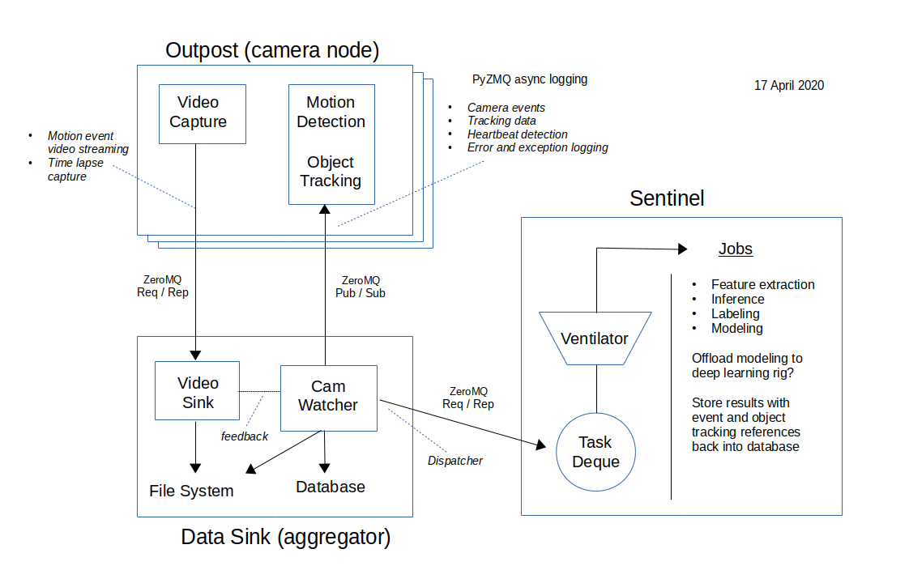
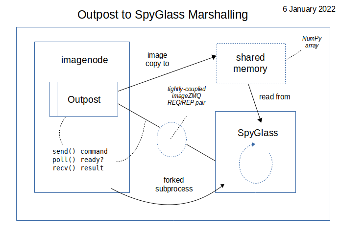
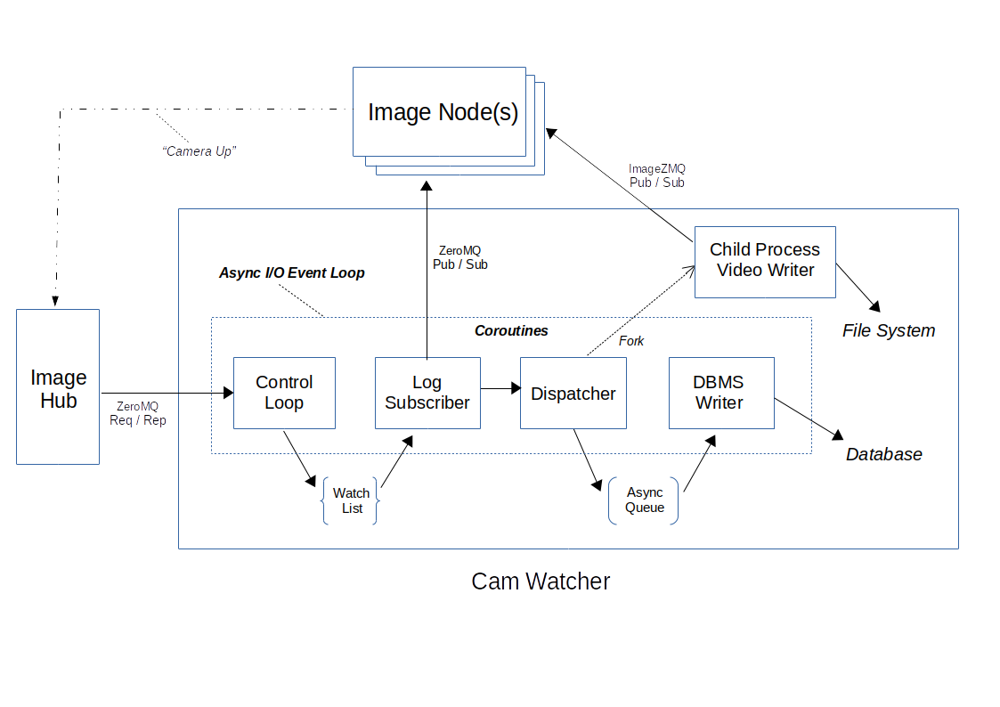
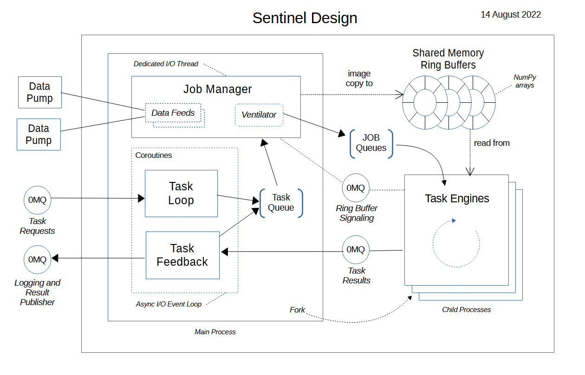
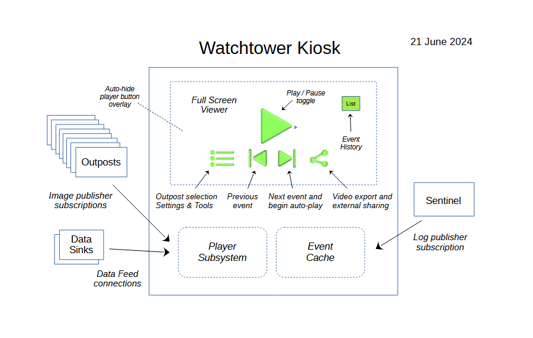
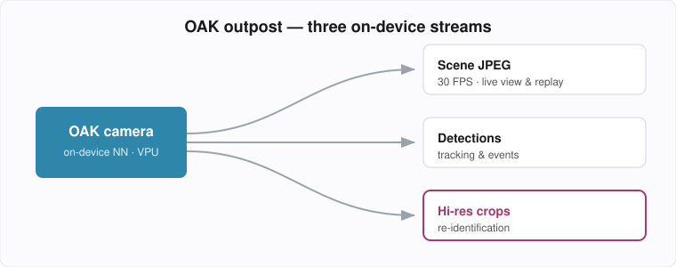

=================================================
SentinelCam: vision and machine learning pipeline
=================================================

Introduction
============

**SentinelCam** is an ongoing development effort. The project goal is to develop a small-scale
distributed computer vision and machine learning pipeline hosted on a network of Raspberry Pi computers.
The practical application for this is to build a stand-alone embedded system served by multiple
camera feeds that can easily support such requirements as presence detection within the context 
of smart home automation.

.. contents::

Initial project goals
=====================

Early project goals are to be able to recognize people and vehicles that are known to the house.
Differentiating between family, friends, guests, neighbors, *and strangers*. Identifying package and
mail delivery. Knowing when a strange car has pulled into the driveway.

Significantly, any unknown face should automatically be enrolled and subsequently recognized going
forward. Unknown faces can always receive a "formal introduction" later by tagging and categorizing
as desired.

- Able to operate independently of any cloud-based services or externally hosted infrastructure
- Automatic video capture should be triggered by motion detection and stored for review/modeling
- Motion detector will provide basic object tracking for the duration of the event
- Object identifiers and associated tracking centroids are logged as an outcome of motion detection
- A live video feed from each camera must be available for on-demand viewing as desired
- Video playback should support an optional timestamp and any desired labeling of inference results
- Optional time-lapse capture

High-level design concept
=========================

The birds-eye overview of the early conceptual framework is portrayed by the following sketch.

Multiple **Outposts** are each a camera node. These are not rigged with internal disk storage.
One or more *data aggregators* are responsible for accumulating reported data and capturing
video streams.

Realtime analysis of logged data from each **Outpost** feeds a *dispatcher* responsible for
submitting tasks to the **sentinel**. Inference and labeling tasks should be prioritized over
modeling runs. The **sentinel** will need to be provisioned with adequate memory and computing
resources.

One of the biggest challenges to implementing a workable solution to this problem, operating
over a network of small single board computers such as the Raspberry Pi, is making effective
use of the limited resources available.

This is best served by a "divide and conquer" approach. Spread out the workload for efficiency,
employing parallelization where helpful for processing incoming data sets. Keep overhead to a
minimum. Each node in the network should serve a distinct purpose. Take care, do not overburden
any individual node, while watching out for untapped idle capacity. Orchestration is key. Balance
is required.

Although each **Outpost** node operates independently, any detected event could be directly
related to an event being simultaneously processed by another node with an overlapping or
adjacent field of view.

Object tracking references and related timestamps become the glue that ties inference results
back to the original source video streams.

   Ideally, this would be something hidden away in walls, cabinets and closets... and
   then mostly forgotten about. Because it will just work, with limited care and feeding.
   *Dream big, right?*

Leveraging imagenode
====================

Fortunately, early research led to the `imageZMQ <https://github.com/jeffbass/imagezmq>`_
library authored by Jeff Bass. This was key to resolving data transport issues between
nodes.

For building out the functionality of the **Outpost**, it quickly became obvious that
Jeff's **imagenode** project could provide scaffolding that was both structurally sound and
already working. This project has been forked as a submodule here. Additional details
regarding what was inherited and what was added are documented in
`Outpost History <docs/OUTPOST_HISTORY.md>`_.

Most significantly, this enhanced **imagenode** module completely encapsulates all the
functionality required by the **Outpost**, while continuing to serve in its existing
role.

Project status
==============

**SentinelCam** is an on-going research experiment, built on a foundation that is no longer in flux.
The core pipeline — ``Outpost``, **camwatcher**, **datapump**, and **sentinel** — is stable and in
continuous production use. The **watchtower** continues to evolve, mostly through UI improvements and
whatever new features come to mind. The active frontier is the recognition work being built on top of
all this; see the `Research and development roadmap`_ below.

Outpost design
--------------

Imagine a lonely sentry standing guard at a remote outpost. Each outpost is positioned to watch over
the paths leading towards the inner fortifications. Sentries are tasked with observing, monitoring,
and reporting anything of interest or concern. Such reports should be sent back to central command
for analysis and decision making.

This analogy represents the underlying concept behind the ``Outpost`` design. Each node watches its
field of view and reports what it sees. When a recognizable subject appears, the node follows it —
tracking each subject as a distinct identity and reporting its *behavior* through the scene (arrival,
movement, lingering, departure) as an event. A ``SpyGlass`` can be deployed for a closer look at
selected frames. The node observes and routes; the heavier analysis is delegated back to central
command.

The ``Outpost`` is implemented as a ``Detector`` for an **imagenode** camera. This allows it to easily
slip into the existing **imagenode** / **imagehub** / **librarian** ecosystem as supplemental functionality.

Two key enhancements provide the essential wiring to make this possible. Log and image publishing over
ZeroMQ and imageZMQ respectively.

  *How Sentinelcam benefits from image and logfile publishing*

- Image capture can be quickly initiated by an event in progress. This supports multiple image
  subscribers, for both on-demand capture and live viewing in parallel.

- Error and warning conditions are accumulated in a centralized repository as they occur. This
  simplifies management and review of system health over time and avoids reliance on SD cards with
  limited storage capacity which could be dispersed across potentially dozens of individual camera nodes.

- More importantly, logged event notifications including information related to an event in progress
  are then available as data available and to multiple interested consumers.

Images are transported as individual full-sized frames, each compressed into JPEG format. For
smooth realistic video playback, the pipeline needs to run with a target throughput of somewhere
close to 30 frames per second, ideally.

Obtaining this goal on a Raspberry Pi can quickly become a significant challenge when building out
the pipeline with CPU-intensive tasks such as object identification and tracking.

To achieve the highest publishing frame rate possible, an ``Outpost`` node can employ a ``SpyGlass``
for closer analysis of selected frames. The idea is to keep the main pipeline lean for quickly
publishing each frame, while heavier per-subject inference runs in parallel. This is a
multiprocessing solution.

Tracking and event management are handled by a persistent, *source-agnostic* host-side tracker shared
by every camera node. Rather than reacting to raw motion, the tracker follows each subject as a distinct
identity and drives events from *behavior* — a subject arriving, crossing the field of view, lingering,
or departing. Motion is no longer the trigger; it is demoted to a scheduler that decides which frames
are worth an inference. The same lifecycle runs on every node type — only the source of detections differs.

The guiding division of labor: **the Outpost collects and routes; the sentinel thinks.** Each node keeps
its main pipeline lean enough to publish near 30 frames per second, runs only lightweight per-frame work
— tracking, event management, selective capture of frames and regions, and optional edge inference on a
``SpyGlass`` — and hands anything heavier to batch jobs running on the **sentinel** itself.

This division is also what makes the design *commodity-first* without capping its ceiling. A plain
Raspberry Pi with a standard camera is the on-ramp — accessible, no exotic dependencies, no lock-in —
and runs the full lifecycle on CPU alone. It works, though CPU-bound inference is modest and
motion-gated. On better hardware the system becomes what it was imagined to be. A Luxonis OAK camera
(DepthAI VPU) runs object detection on-device every frame at full rate and hands the Pi's CPU back —
but the real transformation is *what it can now capture*. Beyond the reduced-resolution scene stream
used for viewing, the camera produces **high-resolution, class-specific crops taken straight from the
sensor**, at a fidelity the published frames never carry. Those crops are the ground-truth imagery the
entire re-identification effort stands on — the genuinely transformative capability here, not a mere
speed-up.

The architecture refuses to choose between the two worlds: the *same* source-agnostic lifecycle
degrades gracefully down to the bookshelf Pi and scales up to the OAK, with accelerators such as an
Intel NCS2 or Google Coral fitting in between.

The closer-analysis ambition is unchanged. If a person is detected, is there a face in view, and can it
be recognized? Was it a package delivery, or a postal carrier? If the subject is a vehicle, can the make,
model, or color be determined? Is there a license plate visible? These in-depth questions are the work of
the re-identification pipeline — the ``Outpost``'s job is to capture the ground-truth imagery that makes
them answerable.

Further detail on the design, structure, and operation of the ``Outpost`` is documented in
`Tracking and event-management architecture <docs/TRACKING_ARCHITECTURE.md>`_. The project's earlier
motion-driven, cascading-lens lineage — the proof of concept this evolved from — is preserved in
`Outpost History <docs/OUTPOST_HISTORY.md>`_.

Camwatcher design
-----------------

The **camwatcher** is the collection point on each data sink, subscribing to the ``Outpost`` nodes
assigned to it and writing everything they report to disk. See below for a high-level design sketch.

Depending on how many camera events are occuring at any one time, each **camwatcher** node can support
a limited number of ``Outpost`` publishers. As the total number of deployed camera nodes increase,
additional data sinks will need to be included in the system architecture design to distribute the load.

- Image publishing over imageZMQ supports multiple subscribers concurrently. Event analysis and
  image capture can occur, while simultaneously supporting a live camera feed on one or more video
  displays.

- Log publishing over ZeroMQ has also proven to be very effective. The **camwatcher** design
  exploits this in a couple of ways. One is for responding to activity being reported from the
  ``Outpost`` nodes as quickly as possible. Additonally, task results from analysis running on
  the **sentinel** are collected using this same technique. See the ``sentinel`` setting in the
  `camwatcher.yaml <camwatcher.yaml>`_ file for how this is configured.

The *CSV File Writers* run as dedicated I/O threads. This component is responsible for receiving
queued data records and writing them into CSV-format text files, as described below.

Data model
----------

.. image:: docs/images/DataStore.svg
   :alt: Outposts feed the camwatcher, which writes three stores on the data sink; the datapump serves them to clients

Everything the system collects lands on the filesystem of a data sink, in three stores, each organized
into one folder per date. There is no database. Every stored file is named for the event it belongs to,
and the date folder narrows any search to a single day. That buys fast, direct access to any event, and
any moment within it, on very small hardware — with nothing more fragile than a text file to corrupt,
and a layout anyone can inspect with ``ls``.

- **Event index and tracking data**, as CSV text. A daily index of events, and for each event a detail
  file per result type: the ``Outpost``'s tracking records, its crop correlations, and each result set
  produced by analysis on the **sentinel**. Small, and the analytical heart of the system.

- **Scene frames**, every published frame of every event stored as an individual JPEG. Frames rather
  than video, because the analysis downstream works on still images, and a stored frame keeps every
  detail the camera published. The storage this demands is best characterized as greedy. *Very greedy*.
  Scene frames are 99% of the bytes.

- **Crops**, the high-resolution, subject-sized images cut from the full sensor frame by an OAK camera.
  A sliver of the storage, and the source imagery the re-identification work stands on.

That imbalance shapes retention. Scene frames expire on their own clock, while the event record, its
tracking data, and its crops outlive them. An old event can no longer be replayed as video, but what
happened — and the imagery worth learning from — remains. The policy is described in
`Data Management <docs/DATA_MANAGEMENT.md>`_.

Schemas, file naming, how the stores join together, and the complete access API are documented in
`Data Model <docs/DATA_MODEL.md>`_.

DataPump and DataFeed
---------------------

Collecting and storing data are only steps one and two. What logically follows, is easy access
for analysis. Once tasked with event review, the **sentinel** will be hungry for images and
any tracking records generated by the outpost.

This potentially ravenous fast-food style appetite is to be fed with requests to a ``DataFeed``,
a library providing application programs with access to any desired set of images and tracking
data collected by a **camwatcher**. The **datapump** is the stand-alone server process on each
data sink which responds to those requests over the network. Communication between components is
via imageZMQ using a REQ/REP socket pair, so tracking data travels as pandas DataFrames on the same
transport that carries images throughout the system.

.. code-block:: python

  class DataFeed(imagezmq.ImageSender):  # REQ socket - sends requests to a DataPump
  class DataPump(imagezmq.ImageHub):     # REP socket - responds to DataFeed requests

Any module needing access to **camwatcher** data simply needs to create a ``DataFeed`` instance,
naming the network address of a running **datapump**. The **sentinel**, the **watchtower**, and
analysis notebooks all read through it. Every captured frame is individually addressable: if the
images of interest are not available until 3 seconds after the start of the event, the first 90-100
frames are simply skipped.

The complete ``DataFeed`` API, along with examples of typical access patterns, is documented in
`Data Model <docs/DATA_MODEL.md>`_.

Sentinel design
---------------

The **sentinel** is the batch analysis engine. It accepts job service requests as JSON over ZeroMQ.
Parallelization is provided by a multi-processing design, allowing multiple tasks to run at once.
Employs a dedicated I/O thread to supply image requests for use in analysis tasks through a set of
ring buffers in shared memory.

The **sentinel** module is conceived as the primary inference and signaling center; the very
heartbeat of the larger system.

Workloads are configured through a set of YAML files. Tasks can be configured by job class to
have an affinity for a certain task engine. Perhaps one of the task engines has a dedicated
inference co-processor and is kept ready for immediate supplemental event analysis.

- A separate engine can be used for work that only requires CPU, such as background
  maintenance tasks.

- Workloads can be reconfigured during idle time periods, such as at night. With fewer camera
  events occurring, co-processors can be re-tasked for larger batch analytical sweeps of the data.

- Configurable pipeline definitions are supported through task chaining and task aliasing.

See `sentinel.yaml <sentinel.yaml>`_ for an example of how this is configured.

Watchtower Kiosk
----------------

The **watchtower** is the SentinelCam wall console. Designed for the Raspberry Pi 7-inch touchscreen
display, this is a combination live outpost viewer and prior event display tool showing model inference
results. They subscribe to **sentinel** log publishing, and are continually reviewing task activity.

These nodes are configured as kiosks with an always-on display. Although originally conceived as a wall mount,
depending on case selection preferences, they can also be adapted for use on a desk or table top.
In daily production use, the **watchtower** is also the component most likely to keep changing: it
is where new features tend to surface first.

As new events occur, a sample image is selected based on inference results available at that time. Labeling
and bounding box overlays from neural net outputs are drawn on the image along with a time stamp. This selected
image is pushed to the viewer display and used as the thumbnail in the list of outpost nodes.

The current view selection is also automatically changed to whichever outpost produced the event. This results
in an immediate visual update on the display. With multiple outposts capturing events, an ever-changing slideshow
presenting the most recent event capture is provided. Tapping on the play button from an idle state will show the
live camera view from the outpost with most recent activity. Tapping on the previous button will replay the event
which was shown on the viewer.

The **watchtower**, though functional, is still being developed. It has an open-ended feature list, much of which
is still only whiteboarded at this point. Its primary purpose as a live camera viewer and event review tool has been
realized. Conceptually, this will become the central hub for operational control and status, model development feedback, and general administration.

  Currently implemented features include:

  - Storage analysis report
  - System health monitoring and status display 
  - Video export and external sharing of event captures
  - An interactive motion detection calibration and tuning tool

Research and development roadmap
================================

Development is proceeding along multiple paths simultaneously. The categories below do not
describe an all-inclusive list, they are simply interrelated areas of current focus. The
conceptual framework driving the overall project is larger in scope. Updates are published
here on an incremental basis as new functionality is fleshed out, proven, and stabilized.

For all machine learning aspects of SentinelCam related to computer vision, the system is
designed so that models are trained on data which has been collected by the deployed Outpost
cameras.

The recognition flywheel
------------------------

All of this is heading towards a system that gets better at knowing who and what it sees, simply by
continuing to watch. Recognition as a loop that keeps turning: capture, organize, match, confirm,
learn. Then back to capture, with a better idea of what is worth collecting. Each turn of the wheel
should make the next one easier.

Vehicles come first. The street camera is the richest source of data in the system, and the
groundwork is already in place: high-resolution crops from the OAK cameras, and a persistent track
identity binding each crop to the vehicle's path through the scene and to its measured speed. Faces
follow on the same machinery. What carries over from one to the other is the infrastructure and the
methodology, rather than any particular model.

A few ideas shape the design:

- **Knowing what kind of event it was.** A car passing by and a car pulling into the driveway are
  different events, calling for different handling, capture included.

- **A memory above the event level.** Data is organized by date and event, which is right for capture
  and wrong for recognition. Knowing that this is the third visit from the same car this week takes a
  summary of events and a registry of known identities: a role the **librarian** was always meant to
  play.

- **Matching, rather than periodic retraining.** New crops are compared against a gallery of confirmed
  examples. Learning becomes the continuous curation of that gallery, instead of an occasional
  retraining exercise.

- **Human confirmation as the learning event.** A tap on the **watchtower** to confirm or correct a
  match is the feedback that turns the wheel, keeping human input to a bare minimum.

None of this exists yet, and the details will change as it gets built. Most of the development work
ahead is in its service. The facial recognition pipeline that follows is the first working instance
of the same loop, built before the rest of the machinery existed.

Facial recognition and learning pipeline
----------------------------------------

The premier machine learning component for SentinelCam was this facial recognition pipeline, designed as
as a continuous learning loop, and it integrates data capture, organization, matching, human confirmation, 
and model refinement.

Strategy
........

There would seem to be broadly two strategies to follow when designing a facial recognition system.

  1. Formal data collection accompanied by something like a "look here to be recognized" solution.
  2. Casual data collection and recognition based on a catch-as-catch-can philosophy.

SentinelCam adopts the latter approach.

New individuals are learned through an on-going cycle of data collection and model refinement.
This is a semi-supervised life cycle relying on human feedback for both confirming the identity
of new individuals learned, and oversight into the health of the recognition model evolution
process.

   The lofty goal is: limited care-and-feeding requiring only a bare minimum of human input and feedback.

For the initial stand-up of a new deployment, the system needs to be introduced to the persons
who should be known at start-up. This is best served by a conscious act of data collection. Such
an effort would entail each individual spending some time standing alone in front of an Outpost node,
facing the camera lens. Ideally, with good lighting for illumination of the images. This needs to
allow for several seconds of elapsed time; including minor head movements and changes in direction
of gaze, perhaps while conversing with someone off-camera, to capture a variety of expressions.
The more of this, the better.

Challenges
..........

There are a number of inherent challenges to the SentinelCam design that must be overcome.

Partly this is related to infrastructure constraints. This system is designed to run on small
low-voltage embedded devices, rather than operating on costly rackmount hardware, or a virtual
server farm in the clouds. The more CPU/GPU brought to bear, the more energy and expense needed
to make it all work.

*Infrastructure is not the only challenge*. Design philosophy presents a more complex set of obstacles.

- High image publishing frame rates are required to provide full motion video for on-demand viewing,
  data gathering for analysis and playback, and timely response to events in progress.
- Thus for efficient collection, transport, analysis, and storage of data: images must often be scaled
  down to XGA or even VGA sizes.
     *This, is where infrastructure constraints have the greatest impact*.
     Detected faces within these resulting images can be quite small.
- Lighting conditions are rarely supportive of quality image collection, sometimes resulting in deep
  shadows and poor contrast.
- Except for when the subject is gazing directly at the camera, collected images often present profile
  views and oblique perspectives.
- Persons may be actively moving through the field of view, and not stationary. This can sometimes
  result in images containing rolling shutter artifacts which produce blurry, apparently out of focus, faces.
- At high frame rates, a single Outpost event can potentially capture hundreds of images containing
  facial data. Only a small subset of these images might return a recognition result with high confidence.
- Often, none of the collected images will have the desired quality needed for use as feedback to improve
  the recognition model.
- Sometimes, failures in recognition tasks result from the introduction of new individuals not seen
  before. The system needs to be able to discern the difference, and attempt to remember each new person
  so that they can be recognized in the future.

Some of this can be alleviated with planning and forethought. Lighting and camera placement are obvious
factors that, when given careful consideration, can greatly improve overall results.

Solution approach
.................

There are a triad of goals that need to be addressed.

  1. Determining when an individual has been identified with confidence.
  2. Recognizing when a new person has been encountered.
  3. Selecting a set of candidate images for improving the recognition model.

SentinelCam uses facial embeddings produced by the `OpenFace <https://cmusatyalab.github.io/openface/>`_ deep
neural network as the foundation for a solution. This model transforms a facial image into a set of numeric
embeddings which describe an 128-dimension unit hypersphere representing the face. These values support a
comparison based on the Euclidean distance between two faces such that the greater the distance, the more
likely they are taken from two different individuals.

These embeddings are used to train an SVM classifier based on the face captures collected from known individuals.

Whenever the probability of the determined result from the model falls below a confidence threshold, a measurement
using an Euclidean distance calculation is implemented as an additional confirmation. Distance is evaluated against
a baseline representation kept for each known individual. The plan-B fallback is implemented by a search for the
closest comparable known face.

This ensemble approach not only bolsters classification results, it presents a solution to the open-set recognition
problem inherent to SentinelCam design goals. The distance metric is helpful in the quest to identify and remember
newly introduced faces.

See `FACIAL_RECON_LEARNING.md <docs/FACIAL_RECON_LEARNING.md>`_ for more details on the facial recognition and
learning pipeline.

Outpost
-------

Beyond simple object detection and tracking, some inference tasks can be pushed out to the
edge where appropriate and helpful. Applying more sophisticated models across a sampling
of incoming frames could help determine whether a motion event should be prioritized for
closer analysis by the **sentinel**.

Additional performance gains can be achieved here by equipping selected ``Outpost`` nodes with
a coprocessor. SentinelCam currently supports the Google Coral USB Accelerator for this purpose.
Proper hardware provisioning can allow for running facial and vehicle recognition models directly
on the camera node. When focused on an entry into the house, any face immediately recognized would
not require engaging the **sentinel** for further analysis.

Essentially, this could enable a camera to provide data in real-time for discerning between
expected/routine events and unexpected/new activity deserving of a closer look.

Luxonis OAK cameras
...................

The ``Outpost`` can use an OAK camera from *Luxonis* as its primary data collection device — an
"AI-included" camera with an on-board VPU co-processor. Their **DepthAI**
`software libraries <https://docs.luxonis.com/software>`_ provide for model upload and customizable
on-device pipelines. The pipeline defined here produces three concurrent outputs, all at 30
frames/second:

1. **Object detection on every frame** (MobileNetSSD), feeding the host-side tracker directly — no CPU inference required on the Pi.
2. **A reduced-resolution scene stream**, encoded to JPEG on the camera, for live viewing and publication to the **camwatcher**.
3. **High-resolution, class-specific crops** cut on-device from the full-resolution sensor frame — the ground-truth imagery for re-identification, at a fidelity the published scene stream cannot carry.

The first two outputs replace, in dedicated silicon, what a CPU-bound node otherwise does in software.
The third is genuinely new capability — a plain camera cannot provide it, and it is the foundation
under the whole re-identification direction. Selected crops are also handed to the ``SpyGlass`` for
supplemental edge inference while an event is in progress (face or attribute extraction close to the
source), without engaging the **sentinel**. The result is a remarkable amount of analytical
performance on an embedded, low-voltage edge device.

See `Tracking and event-management architecture <docs/TRACKING_ARCHITECTURE.md>`_ for the full
pipeline — how detections, the scene stream, and the high-resolution crops flow through capture,
storage, and analysis.

Additional documentation
========================
- `Version history and Changelog <HISTORY.md>`_
- `Tracking and event-management architecture <docs/TRACKING_ARCHITECTURE.md>`_
- `Outpost event protocol -- the wire contract <docs/EVENT_PROTOCOL.md>`_
- `Outpost configuration and tuning reference <docs/OUTPOST_CONFIGURATION.md>`_
- `Outpost history -- the imagenode fork and the motion-driven era <docs/OUTPOST_HISTORY.md>`_
- `Facial recognition, model training, and machine learning pipeline <docs/FACIAL_RECON_LEARNING.md>`_
- `Data model -- storage, schemas, and the DataFeed API <docs/DATA_MODEL.md>`_
- `Data management policies and retention strategy <docs/DATA_MANAGEMENT.md>`_
- `Ansible playbooks for provisioning, application deployment, and configuration <devops/ansible/README.md>`_
- `Automated edge deployment and CI/CD pipeline <devops/README.rst>`_
- `Development blog <https://blog.swanriver.dev>`_

Technology foundation
=====================

**SentinelCam** is being developed and tested in a labratory built on top of the following core
technologies and libraries.

- Raspberry Pi 4B
- Raspberry Pi 5
- Raspberry Pi OS, *Debian 12 (bookworm)*
- Python 3.11
- OpenCV 4.11
- OpenVINO
- picamera2
- Luxonis OAK-1
- Intel NCS2
- NVIDIA Jetson Nano DevKit
- Google Coral USB Accelerator
- TensorFlow Lite
- MobileNetSSD
- DepthAI v3
- scikit-learn
- NumPy
- imageZMQ
- ZeroMQ
- pandas
- papermill
- MessagePack
- OpenFace
- Ansible

Acknowledgements
================

- Dr. Adrian Rosebrock and the PyImageSearch team; his book: *Raspberry Pi for Computer Vision*
  has been an invaluable resource.
- Jeff Bass (imagezmq, imagenode, and imagehub); his outstanding work has allowed this project
  to get off to a fast start.
