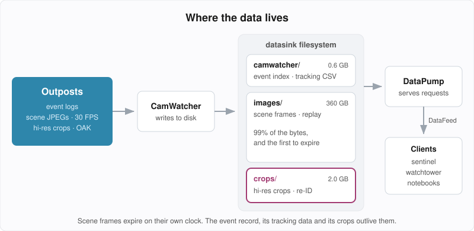
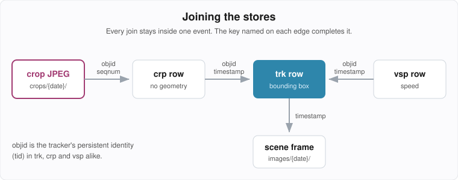
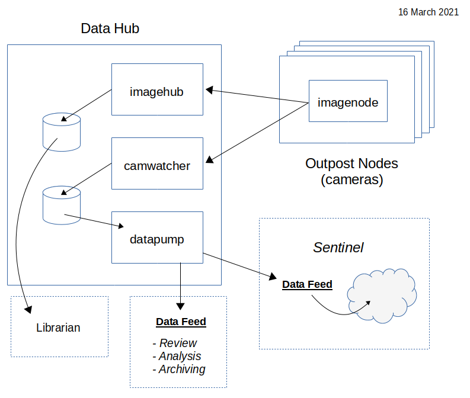

# Data Model

What SentinelCam stores at rest, how the pieces relate, and how to get them back. The
**CamWatcher** writes everything described here to the filesystem of a data sink; the
**DataPump** serves it over the network; the **DataFeed** client library is how every
other component — the **sentinel**, the **watchtower**, analysis notebooks — reads it.

This document is the at-rest companion to [EVENT_PROTOCOL.md](EVENT_PROTOCOL.md), which
covers the same data on the wire. Retention *policy* — what is worth keeping and for how
long — is covered in [DATA_MANAGEMENT.md](DATA_MANAGEMENT.md).

> **Verified against the shipping implementation.** Files are written in
> `camwatcher/camwatcher.py`, read by `camwatcher/datapump/sentinelcam/camdata.py`, served by
> `camwatcher/datapump/datapump.py`, and fetched by `sentinelcam/datafeed.py`. If this document
> and that code disagree, the code is right — fix this document.



---

## 1. The stores

Three folder trees on each data sink, each partitioned into `YYYY-MM-DD` date folders:

| Store | Contents | Measured on data1 (0.3.1) |
|-------|----------|---------------------------|
| `camwatcher/` | Event index and tracking detail, as CSV text | 604 MB |
| `images/` | Scene frames, one JPEG per captured frame | 360 GB |
| `crops/` | High-resolution subject crops, OAK nodes only | 2.0 GB |

Scene frames are 99% of the bytes. Everything the recognition work consumes — tracking
data, sentinel results, crops — is 0.7%. That imbalance is why the two expire on separate
clocks (§6).

There is no database. Every stored filename begins with the UUID of the event it belongs to,
and the date folder narrows the search to one day. This is deliberately simple: fast direct
access to any event and moment on small hardware, with nothing to corrupt beyond a text
file, and a layout anyone can inspect with `ls`.

```
~/sentinelcam/
├── camwatcher/
│   └── 2026-09-20/
│       ├── camwatcher.csv                                    # event index, no header
│       ├── health.json                                       # sentinel HEALTH records (JSONL)
│       ├── 42fc4bb46cc611ebb942dca63261a32e_trk.csv          # outpost tracking
│       ├── 42fc4bb46cc611ebb942dca63261a32e_crp.csv          # crop correlation (OAK)
│       ├── 42fc4bb46cc611ebb942dca63261a32e_vsp.csv          # sentinel result: vehicle speed
│       └── ...
├── images/
│   └── 2026-09-20/
│       ├── 42fc4bb46cc611ebb942dca63261a32e_2026-09-20_07.32.12.856029.jpg
│       ├── 42fc4bb46cc611ebb942dca63261a32e_2026-09-20_07.32.12.889361.jpg
│       └── ...
├── crops/
│   └── 2026-09-20/
│       ├── 42fc4bb46cc611ebb942dca63261a32e_17_4193_car_entry.jpg
│       ├── 42fc4bb46cc611ebb942dca63261a32e_17_4230_car_centre.jpg
│       └── ...
└── storage_report/storage_report.pickle                      # nightly, from storage_analysis.py
```

Folder locations come from the CamWatcher's `csvfiles`, `images` and `crops` settings and the
DataPump's `datafolder`, `imagefolder` and `cropfolder`, all rendered by Ansible from
`sentinelcam_standards.yaml`.

**Event data is always addressed by date.** There is no index spanning dates, and every
DataFeed call takes the date as well as the event. Use the event's *index date* — the date
of its row in `camwatcher.csv`. Files do not always sit under that date, though:

- **Scene frames** go under the date of the event's first frame, so a scene frame follows
  its event even across midnight.
- **Crops** are filed by the date they were *received*. The crop descriptor carries no
  capture timestamp, so a crop received just after midnight — or one arriving late, after
  its event has closed — can land a day later than its event. The DataPump looks for a crop
  only under the date it is given.

---

## 2. The event index — `camwatcher.csv`

One index per date folder. No header row. **One row per (event, result type)**, not one row
per event: an OAK event that has been through vehicle-speed analysis has three rows —
`trk`, `crp` and `vsp` — sharing an event id.

| Column | Type | Description |
|--------|------|-------------|
| `node` | str | Outpost node name |
| `viewname` | str | Camera view name |
| `timestamp` | datetime | Start of the event |
| `event` | str | Event UUID (32 hex characters) |
| `width` | int | Scene frame width in pixels |
| `height` | int | Scene frame height in pixels |
| `type` | str | Result type this row announces (§3) |

```
east,StreetView,2026-09-20T07:32:12.856029,42fc4bb46cc611ebb942dca63261a32e,768,432,trk
east,StreetView,2026-09-20T07:32:12.856029,42fc4bb46cc611ebb942dca63261a32e,768,432,crp
east,StreetView,2026-09-20T07:32:12.856029,42fc4bb46cc611ebb942dca63261a32e,768,432,vsp
```

Who writes a row:

- `trk` — the CamWatcher, on the outpost's `start` record.
- `crp` — the CamWatcher, on the first crop correlation record it sees for the event.
  The crop stream has no `start` of its own, so the CamWatcher creates the row, carrying the
  scene size recorded at `start`. A `crp` row reading `0x0` means that size could not be
  recovered after a CamWatcher restart.
- sentinel result types — the CamWatcher's `SentinelAgent`, on the first result a task
  publishes for the event.

All index writes go through the single `CSVindex` process. Nothing else edits this file.

To list *events* rather than result sets, filter on `type == 'trk'`: every event has exactly
one `trk` row.

---

## 3. Tracking detail — `{EventID}_{type}.csv`

One file per event per result type, always with a header row. The type code in the
filename matches the `type` column of the index row.

### 3.1 Result types

| Type | Written by | `objid` is | `classname` carries |
|------|-----------|------------|---------------------|
| `trk` | Outpost, via CamWatcher | the tracker's persistent identity (`tid`) | detector label with confidence, e.g. `car: 0.96` |
| `crp` | Outpost, via CamWatcher (OAK only) | `tid` | crop class, e.g. `car` |
| `vsp` | sentinel `VehicleSpeed` | `tid` | speed, e.g. `33.4 mph` |
| `obj` | sentinel `MobileNetSSD_allFrames` | detection index within the frame | detector label with confidence |
| `fd1` | sentinel `GetFaces` | face index within the frame | `Face` |
| `fr1` | sentinel `FaceRecon` | inherited from the `fd1` row it examined | `{name}: {prob}% {stats}` |

The type codes for sentinel tasks are set in each task's configuration, so new tasks add
new codes without changes to storage.

**`objid` only identifies a subject in `trk`, `crp` and `vsp`.** Those three share the
outpost's persistent `tid`, which is what makes the cross-type joins in §5 work. In `obj`
and `fd1` it is just a position in a list of detections, and says nothing about identity
from one frame to the next.

### 3.2 Geometry schema — `trk` and every sentinel result type

```
timestamp,objid,classname,rect_x1,rect_y1,rect_x2,rect_y2
```

| Column | Type | Description |
|--------|------|-------------|
| `timestamp` | datetime | Capture time of the frame |
| `objid` | str | Subject identifier (see §3.1) |
| `classname` | str | Label (see §3.1) |
| `rect_x1` `rect_y1` | int | Top-left corner, absolute scene pixels |
| `rect_x2` `rect_y2` | int | Bottom-right corner, absolute scene pixels |

For sentinel results the timestamp is that of the scene frame the task analyzed.

### 3.3 Crop correlation schema — `crp`

```
timestamp,objid,seqnum,detidx,classname,phase
```

| Column | Type | Description |
|--------|------|-------------|
| `timestamp` | datetime | Capture time of the frame the crop was cut from |
| `objid` | str | `tid` of the cropped subject |
| `seqnum` | int | Device frame sequence number |
| `detidx` | int | Index of the detection within that frame |
| `classname` | str | Crop class |
| `phase` | str | Which sampling phase selected it: `entry`, `centre` or `far` |

A `crp` row is a **correlation key only**. It carries no bounding box. Geometry comes from
the `trk` row for the same subject and frame (§5). A few rows per event is normal: the
`EventSampler` selects about three crops per subject.

### 3.4 Column types through the DataFeed

`get_tracking_data()` hands back a DataFrame whose column types are fixed on read, not
inferred:

- `timestamp` is `datetime64`, and rows come sorted by it.
- An added `elapsed` column (`timedelta`) gives the time since the event started.
- `objid` and `classname` are **strings**. That is true for every type.
- `rect_*` are nullable integers (`Int64`); `seqnum` and `detidx` are plain integers.

> **`objid` is a string. Never cast it to `int`.** On the wire an outpost sends `obj` as an
> integer, so it is tempting to compare against one. Compared as an int, it matches zero
> rows — silently, with no error. The watchtower's crop overlay had exactly this bug
> (fixed in `21c95d7`), which in multi-vehicle events could caption one vehicle's crop with
> another vehicle's speed.

`vsp` speeds arrive as text. Take the number from the front of the string:
`float(classname.split()[0])`.

---

## 4. Images

### 4.1 Scene frames — `images/{date}/{EventID}_{Timestamp}.jpg`

Every frame the outpost published while the event was open, as the JPEG it was published
in. The timestamp is the capture time, formatted `YYYY-MM-DD_HH.MM.SS.ffffff`:

```
42fc4bb46cc611ebb942dca63261a32e_2026-09-20_07.32.12.856029.jpg
```

Frames are collected on a different stream from the tracking records, so the frame rate
can vary somewhat. Both carry the capture time, however, and a `trk` row normally has a
frame with exactly the same timestamp. Allow for the occasional dropped frame.

Individual frames rather than video: the analysis downstream works on still images, and a
stored frame keeps every detail the camera published. A replay or an export is assembled
from frames on demand (see [DATA_MANAGEMENT.md](DATA_MANAGEMENT.md#video-export)).

### 4.2 Crops — `crops/{date}/{EventID}_{ObjID}_{Seqnum}_{Class}_{Phase}.jpg`

Subject-sized crops cut from the full-resolution sensor frame by the OAK camera, at a
resolution the scene frames never carry. They are the source imagery for
re-identification.

```
42fc4bb46cc611ebb942dca63261a32e_17_4230_car_centre.jpg
```

The filename *is* the key: every field is also a column of the matching `crp` row, which is
how `get_crop_jpg()` locates a crop. There is at most one crop per `(objid, seqnum)`, so
the names never collide.

Crops travel on their own stream, and that stream has no `start` or `end` marking an
event's boundaries. A crop can arrive after its event has closed. Don't assume an event
is still open when its crop turns up.

---

## 5. How the pieces join



```
crop JPEG ──(event, objid, seqnum)──▶ crp row ──(event, objid, timestamp)──▶ trk row
vsp row   ──(event, objid, timestamp)──────────────────────────────────────▶ trk row
trk row   ──(event, timestamp)─────────────────────────────────────────────▶ scene frame
```

- **Crop to geometry.** The `crp` row has no bounding box by design. Match on `objid` and
  `timestamp` in `trk` to find where the subject was in the scene when the crop was cut.
- **Crop to speed.** `vsp.objid == crp.objid` for the same vehicle, which is what lets a
  crop be captioned with that vehicle's speed.
- **Result to frame.** Every geometry-bearing row names a capture time; that is the scene
  frame to fetch.
- **Event to everything.** The index rows for an event list which result types exist for
  it, so you know which tracking sets are worth asking for.

---

## 6. Retention and lifecycle

Two independent clocks:

- **The scene clock.** Scene frames expire after a per-profile number of days
  (`scene_retention_days`, absent = never). The event survives: still indexed, still
  carrying its tracking data and crops. It can no longer be replayed as video.
- **The event clock.** An event judged to have no remaining value is deleted in full:
  index rows, tracking CSVs, scene frames and crops.

Both are driven nightly by the sentinel's `DailyCleanup` task and carried out through
`DataFeed.delete_event()` (§7.3). Events locked as model training ground truth are exempt
from both and keep everything. The policies themselves — profiles, strategies, what counts
as valuable — are in [DATA_MANAGEMENT.md](DATA_MANAGEMENT.md).

Deletion works forward from the index, so a file whose index row is already gone can never
be reached by it. `camwatcher/datapump/orphan_sweep.py` reclaims those. It is run by hand
and only reports unless given `--delete`.

---

## 7. DataPump and DataFeed



The **DataPump** is a stand-alone REQ/REP server on each data sink, subclassing
`imagezmq.ImageHub`. The **DataFeed** is its client library, subclassing
`imagezmq.ImageSender`. Building on imageZMQ keeps one transport for images across the
whole system. DataFrames and lists travel in the same messages as JPEGs:

| Payload | Encoding |
|---------|----------|
| Request | MessagePack dict with a `cmd` key |
| DataFrame | JSON metadata frame, then a pickled DataFrame |
| List or dict | JSON metadata frame, then a zlib-compressed pickle |
| JPEG | imageZMQ `(msg, jpg_buffer)` |
| Control reply | bare bytes, e.g. `b'OK'` |

The metadata frame's `msg` field carries `'OK'` or `'Error'`. The DataFeed doesn't yet check
it. Errors surface instead as empty results or the exceptions below.

### 7.1 Connecting

```python
from sentinelcam.datafeed import DataFeed

feed = DataFeed('tcp://data1:5556', timeout=15.0)
```

One DataFeed per data sink. Each outpost's data lives on the sink its CamWatcher writes to
(see the outpost registry in `site.yaml`). The DataPump port is set in
`sentinelcam_ports.yaml`.

Requests run on a worker thread so a stalled DataPump cannot hang the caller:

- A request that gets no reply within `timeout` seconds raises `TimeoutError`. The DataFeed
  then discards and reconnects its socket, so the next call starts clean.
- A reply that cannot be decoded raises `ConnectionError`.

A DataFeed handles one request at a time. Don't share one across threads.

### 7.2 Reading

| Method | Returns | Raises if empty |
|--------|---------|-----------------|
| `get_date_list()` | `list[str]` of date folders, newest first | — |
| `get_date_index(date)` | Event index DataFrame (§2), newest first | — |
| `get_tracking_data(date, event, type='trk')` | Tracking DataFrame (§3) | `DataFeed.TrackingSetEmpty` |
| `get_image_list(date, event)` | `list[datetime]` of scene frame capture times, chronological | `DataFeed.ImageSetEmpty` |
| `get_image_jpg(date, event, frametime)` | Scene frame JPEG `bytes` | — |
| `get_crop_jpg(date, event, objid, seqnum, classname, phase)` | Crop JPEG `bytes` | — |
| `get_storage_report()` | Storage report `dict`, or `None` if none built yet | — |
| `get_health_summary(date)` | `list[dict]` of that date's sentinel HEALTH records | — |

Notes:

- **Always pass the date.** `get_date_index()` declares a default, but Python evaluates it
  once, at import. A long-running process would be handed the date it started on.
- `TrackingSetEmpty` carries `.date`, `.evt` and `.trk`; `ImageSetEmpty` carries `.date` and
  `.evt`. An event whose scene frames have expired raises `ImageSetEmpty`, the same as one
  that never had frames.
- **A missing image is not an error.** `get_image_jpg()` and `get_crop_jpg()` return a
  1×1-pixel black JPEG when the file doesn't exist or is empty, so a replay loop never stops
  on a gap. Check the decoded image's size if you need to know.
- `frametime` is a `datetime`, normally an element of `get_image_list()`. The crop key
  fields are passed straight from a `crp` row.
- The storage report dict holds `report_version`, `datasink_name`, `generated_at`,
  `disk_summary` and `daily_summary`; the last two are DataFrames. It is rebuilt nightly by
  `storage_analysis.py`, not computed on request.

### 7.3 Deleting

```python
feed.delete_event(date, event, scope='all')     # the whole event
feed.delete_event(date, event, scope='images')  # scene frames only; the event survives
```

Replies with `b'OK'`, or `b'Locked'` for an event held as model ground truth, which is left
untouched. A full delete also broadcasts a deletion alert to subscribers so a kiosk can drop
the event from view.

The two scopes are separate wire commands (`del` and `delimg`) on purpose. A DataPump that
predates scene expiry rejects `delimg` as unrecognized instead of treating it as a full
delete, and a delete cannot be undone.

### 7.4 `EventList`

A convenience wrapper that turns a date, a date range, or a file into a list of
`(date, event)` pairs:

```python
from sentinelcam.datafeed import EventList

EventList(feed, '2026-09-20').get_event_list()                      # one day
EventList(feed, '2026-09-14', date2='2026-09-20').get_event_list()  # a range, inclusive
EventList(feed, '2026-09-20', trk='vsp').get_event_list()           # only events with vsp
EventList(feed, filename='events.txt').get_event_list()             # "date event" per line
```

The `trk` argument selects which index rows count, so it doubles as a filter: only events
that have a result of that type.

### 7.5 Wire commands

For anyone writing a client in something other than the DataFeed:

| `cmd` | Request fields | DataFeed method | Reply |
|-------|----------------|-----------------|-------|
| `dat` | — | `get_date_list` | pickle |
| `idx` | `date` | `get_date_index` | DataFrame |
| `evt` | `date`, `evt`, `trk` | `get_tracking_data` | DataFrame |
| `img` | `date`, `evt` | `get_image_list` | pickle |
| `pic` | `date`, `evt`, `frametime` | `get_image_jpg` | JPEG |
| `cpic` | `date`, `evt`, `crop` | `get_crop_jpg` | JPEG |
| `str` | — | `get_storage_report` | pickle |
| `hth` | `date` | `get_health_summary` | pickle |
| `del` | `date`, `evt` | `delete_event(scope='all')` | bytes |
| `delimg` | `date`, `evt` | `delete_event(scope='images')` | bytes |
| `HC` | — | — | JSON bytes |

`frametime` is formatted like the filename (`YYYY-MM-DD_HH.MM.SS.ffffff`); `crop` is the
filename suffix `{objid}_{seqnum}_{class}_{phase}`. `HC` is the health check the ramrod
observer sends directly; see §7.6.

### 7.6 Client copies

Each component carries its own copy of `datafeed.py`, and the copies have drifted apart.
The sentinel's is the most complete, but no single copy has everything:

| | sentinel | watchtower | event_review |
|---|:---:|:---:|:---:|
| date list, index, tracking, image list, frame | ✓ | ✓ | ✓ |
| `get_crop_jpg`, `get_storage_report` | ✓ | ✓ | |
| `get_health_summary` | | ✓ | |
| `delete_event(scope=...)` | ✓ | full delete only | full delete only |
| `ConnectionError` on an undecodable reply | ✓ | ✓ | |

The tables above describe the protocol, which the DataPump serves in full. Which methods
you can call depends on the copy you import.

`health_check()` is present in all three but does not work as written: it bypasses the
worker thread and sends a plain dict, where the DataPump expects MessagePack. The
ramrod observer builds its own `HC` request instead.

---

## 8. Typical access

The examples assume `feed = DataFeed(...)` and `date = '2026-09-20'`.

### Browse a day

```python
idx = feed.get_date_index(date)
events = idx[idx['type'] == 'trk']                      # one row per event
street = events[events['viewname'] == 'StreetView']
types = idx.groupby('event')['type'].apply(set)         # which result sets each event has
```

### Replay from a point of interest

Frames are individually addressable, so there is no need to read from the start. To
begin three seconds into an event:

```python
import simplejpeg
from datetime import timedelta

frames = feed.get_image_list(date, event)
start = frames[0] + timedelta(seconds=3)
for ts in (t for t in frames if t >= start):
    image = simplejpeg.decode_jpeg(feed.get_image_jpg(date, event, ts), colorspace='BGR')
    ...
```

### A vehicle's crops, captioned with its speed

```python
crp = feed.get_tracking_data(date, event, 'crp')
vsp = feed.get_tracking_data(date, event, 'vsp')
vsp['mph'] = vsp['classname'].str.split().str[0].astype(float)
speed = vsp.groupby('objid')['mph'].last()              # the refined final estimate

for c in crp.itertuples():
    jpeg = feed.get_crop_jpg(date, event, c.objid, c.seqnum, c.classname, c.phase)
    print(c.objid, c.phase, speed.get(c.objid))         # objid is a str in both frames
```

### Where was the subject when the crop was cut?

```python
trk = feed.get_tracking_data(date, event)
c = crp.iloc[0]
box = trk[(trk['objid'] == c.objid) & (trk['timestamp'] == c.timestamp)]
frame = feed.get_image_jpg(date, event, c.timestamp.to_pydatetime())
```

### Events that kept their crops but lost their footage

```python
idx = feed.get_date_index(date)
for event in idx.loc[idx['type'] == 'crp', 'event']:
    try:
        feed.get_image_list(date, event)
    except DataFeed.ImageSetEmpty:
        print(event, 'crops only; scene frames expired')
```

### A week of speed data

```python
import pandas as pd

rows = []
for d, e in EventList(feed, '2026-09-14', date2='2026-09-20', trk='vsp').get_event_list():
    v = feed.get_tracking_data(d, e, 'vsp')
    v['event'] = e
    rows.append(v)
week = pd.concat(rows)
```

### Inside a sentinel task

A sentinel task rarely calls the DataFeed for frames itself. The `JobManager` fetches the
event's tracking data and streams its frames into the task's ring buffer. The task
receives the tracking DataFrame and a `feed` in its constructor, and the frames one at a
time in `pipeline()`. The feed is there for anything beyond that, such as another result
type or the crops.

---

## See also

- [EVENT_PROTOCOL.md](EVENT_PROTOCOL.md) — the same records on the wire, before they are stored
- [DATA_MANAGEMENT.md](DATA_MANAGEMENT.md) — retention policy and why frames, not video
- [TRACKING_ARCHITECTURE.md](TRACKING_ARCHITECTURE.md) — where `tid` comes from and what keeps it stable
